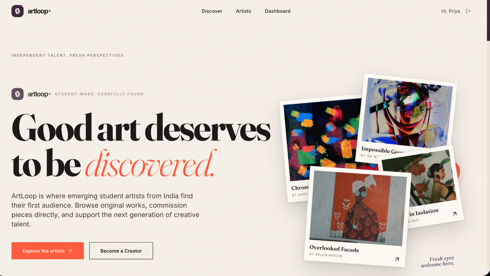

<div align="center">

# ArtLoop 🎨

### A Digital Art Marketplace for Student Creators

Discover emerging student artists, explore original digital artwork, and connect creative talent with new opportunities.

[**Live Demo**](https://art-loop-techformers-2026.vercel.app/) · [GitHub Repository](https://github.com/Srushti707/ArtLoop-Techformers-2026)

</div>

---

## Preview



## About the Project

**ArtLoop** is a student-centric digital art marketplace created for **Techformers 2026 — Problem Statement 01: Digital Art Marketplace for Student Creators**. It aims to help emerging Indian student artists showcase their work and make it easier for buyers to discover artwork and explore creative commissions.

The interface uses an editorial visual identity with a warm ivory background, deep plum accents, coral highlights, and expressive serif typography.

## Features

### For Buyers
- **Discover artwork:** Browse a catalogue with keyword search, category filters, budget filtering, and sorting.
- **Save favourites:** Bookmark artworks using the wishlist.
- **Artwork details:** Review creator provenance, INR pricing, and digital usage rights.
- **Demo checkout:** A two-step purchase flow with validation, unique order IDs, and purchase records.
- **Certificates and downloads:** Generate a Certificate of Authenticity and access available digital deliverables.
- **Buyer dashboard:** View acquired artwork, commissions, and price enquiries.

### For Creators
- **Creator profiles and portfolios:** Present artwork in a dedicated creator space.
- **Upload studio:** Upload artwork, with images stored in IndexedDB.
- **Portfolio management:** Track artwork availability, including one-of-a-kind pieces marked as sold after purchase.
- **Orders and sales:** View recorded orders, gross sales, and estimated creator payouts.
- **Commission tracker:** Manage commission requests through pending, accepted, in-progress, completed, or declined states.
- **Enquiry inbox:** Review buyer enquiries and custom offers.

## Tech Stack

| Technology | Purpose |
|---|---|
| React 18 | UI components |
| TypeScript | Typed application code |
| Vite | Development server and build tooling |
| Tailwind CSS | Styling and responsive UI |
| localStorage | Client-side app state and records |
| IndexedDB | Client-side storage for artwork images |
| Vercel | Deployment |

## Getting Started

### Prerequisites
- Node.js (a current LTS release is recommended)
- npm

### Run locally

```bash
# Clone the repository
git clone https://github.com/Srushti707/ArtLoop-Techformers-2026.git

# Enter the project directory
cd ArtLoop-Techformers-2026

# Install dependencies
npm install

# Start the development server
npm run dev
```

Open the local URL printed by Vite in your terminal.

### Production build

```bash
npm run build
```

## Important Prototype Notes

ArtLoop currently uses **client-side storage** through `localStorage` and `IndexedDB`. The checkout is a **demo transaction flow**, not a real payment gateway. Client-side data is not a substitute for secure server-side authentication, order validation, payment verification, or shared multi-user storage.

A production version would need a secure backend, persistent shared database, server-side purchase validation, payment gateway integration, and appropriate access controls for original digital files.

## Hackathon

- **Event:** Techformers 2026
- **Problem Statement:** PS01 — Digital Art Marketplace for Student Creators
- **Institution:** Usha Mittal Institute of Technology (UMIT), SNDT Women's University, Mumbai

## Links

- **Live application:** https://art-loop-techformers-2026.vercel.app/
- **Source repository:** https://github.com/Srushti707/ArtLoop-Techformers-2026

---

<div align="center">

**ArtLoop — Student-made. Carefully found.**

</div>
